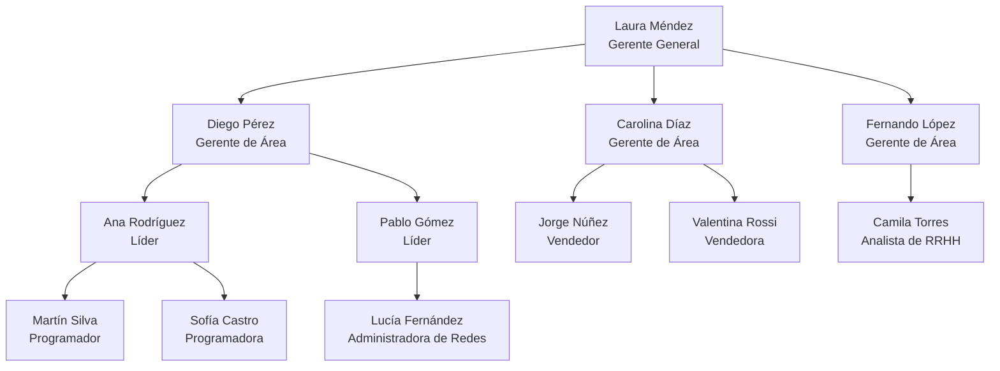
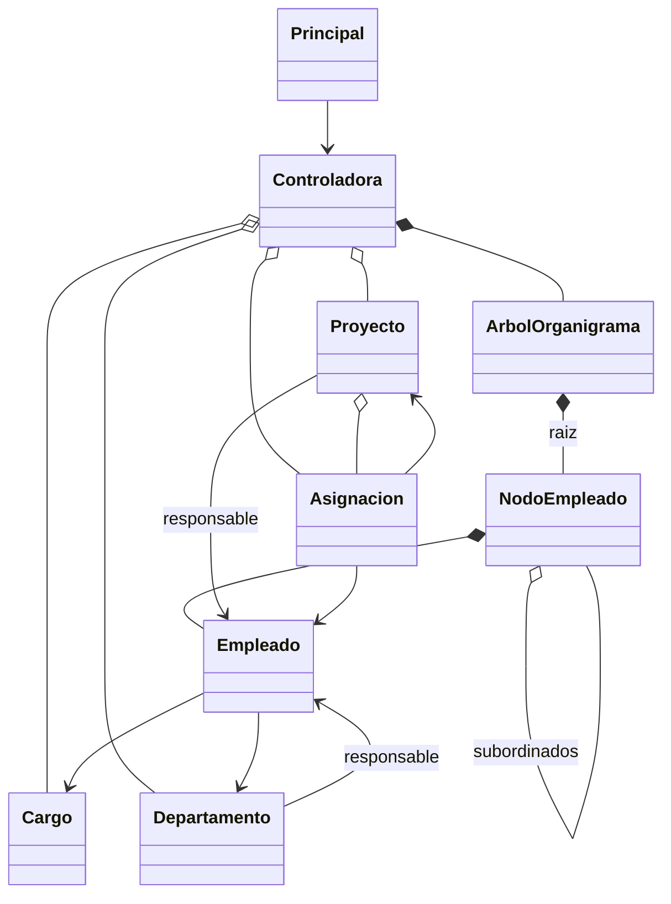

# Sistema de Gestión de Organigrama Empresarial — NovaTech

> Proyecto académico de **Algoritmos y Estructuras de Datos (AYED)** — 2026.
> Aplicación de consola en Java que administra el organigrama jerárquico de la empresa ficticia **NovaTech** mediante un **árbol N-ario**, junto con cargos, departamentos, proyectos y asignaciones.

## Datos de la entrega

| Campo | Información |
|---|---|
| Proyecto | Sistema de Gestión de Organigrama Empresarial |
| Empresa ficticia | NovaTech |
| Materia | Algoritmos y Estructuras de Datos |
| Institución | CTC Rosario |
| Docente | Gonzalo Alonso |
| Alumnos | Mateo Rilla, Juan Meny, Facundo Villalba |
| Lenguaje | Java |
| Modalidad | Aplicación de consola |
| Persistencia | En memoria |
| Fecha de entrega | 3 de diciembre de 2026, 19:00 |

---

## Índice

- [Descripción](#descripción)
- [Objetivos](#objetivos)
- [Características](#características)
- [Tecnologías](#tecnologías)
- [Estructura del proyecto](#estructura-del-proyecto)
- [Organigrama inicial](#organigrama-inicial)
- [Arquitectura](#arquitectura)
- [Modelo de datos](#modelo-de-datos)
- [Algoritmos recursivos](#algoritmos-recursivos)
- [Reglas de negocio](#reglas-de-negocio)
- [Instalación y ejecución](#instalación-y-ejecución)
- [Uso de la aplicación](#uso-de-la-aplicación)
- [Menús disponibles](#menús-disponibles)
- [Identificadores precargados](#identificadores-precargados)
- [Plan de pruebas](#plan-de-pruebas)
- [Diagrama UML](#diagrama-uml)
- [Limitaciones conscientes](#limitaciones-conscientes)
- [Documentación adicional](#documentación-adicional)

---

## Descripción

NovaTech necesita administrar su estructura de personal. Cada empleado tiene un único jefe directo y puede tener cualquier cantidad de subordinados. Esa relación jerárquica se representa con un **árbol N-ario**: el Gerente General ocupa la raíz y los subordinados de cada empleado son sus nodos hijos.

Además del organigrama, el sistema gestiona **cargos**, **departamentos**, **proyectos** y **asignaciones** de empleados. Todos los datos permanecen **en memoria** durante la ejecución; al cerrar el programa se pierden (no hay base de datos ni archivos).

## Objetivos

### Objetivo general

Desarrollar una aplicación Java de consola que permita administrar la estructura jerárquica del personal de NovaTech, junto con las entidades relacionadas, aplicando recorridos, búsquedas y cálculos recursivos sobre un árbol N-ario.

### Objetivos específicos

- Representar el organigrama mediante un árbol N-ario.
- Implementar altas, bajas y modificaciones de las entidades principales.
- Buscar empleados por legajo y por apellido.
- Mostrar la jerarquía completa en recorrido preorden.
- Calcular subordinados totales y masa salarial de un subárbol.
- Obtener la cadena de mando de un empleado.
- Calcular la altura del organigrama.
- Listar empleados pertenecientes a un nivel determinado.
- Reasignar un empleado junto con todo su subárbol.
- Impedir que una reasignación forme ciclos.
- Encontrar el jefe común más cercano entre dos empleados.
- Administrar proyectos, asignaciones y horas de dedicación.
- Precargar datos suficientes para demostrar las funcionalidades.

## Características

### Gestión del organigrama

- Mostrar el organigrama con indentación según el nivel.
- Mostrar el nivel de cada empleado.
- Mostrar la cantidad total de subordinados.
- Contratar un empleado indicando su jefe.
- Modificar cargo, departamento y salario.
- Dar de baja empleados que cumplan las condiciones establecidas.
- Reasignar empleados a otro jefe (moviendo todo su subárbol).
- Buscar por legajo o apellido.
- Consultar altura, niveles y cadenas de mando.
- Calcular el jefe común más cercano.

### Gestión de cargos

- Alta, modificación, baja y listado.
- Validación para impedir la eliminación de cargos utilizados.

### Gestión de departamentos

- Alta, modificación, baja y listado.
- Asignación de responsable.
- Listado y conteo de empleados pertenecientes al departamento.
- Validación para impedir la eliminación de departamentos con empleados.

### Gestión de proyectos y asignaciones

- Alta, modificación, baja y listado de proyectos.
- Cambio de estado (`PLANIFICADO`, `EN_CURSO`, `FINALIZADO`).
- Asignación de empleados, modificación y baja de asignaciones.
- Cálculo de horas totales.
- Validación de empleados repetidos dentro del mismo proyecto.

## Tecnologías

| Componente | Detalle |
|---|---|
| Lenguaje | Java |
| Modalidad | Aplicación de consola |
| Persistencia | En memoria (sin BD ni archivos) |
| JDK verificado | OpenJDK 21 |
| Diagramas | PlantUML (`DIAGRAMA-UML.puml`) |

## Estructura del proyecto

```text
Obligatorio-AYED-2026/
├── README.md
├── LETRA.md
├── DIAGRAMA-UML.puml
├── docs/
│   ├── README.md
│   ├── 01-Descripcion-y-alcance.md
│   ├── 02-Arquitectura-y-clases.md
│   ├── 03-Arbol-y-algoritmos-recursivos.md
│   ├── 04-Manual-de-instalacion-y-uso.md
│   ├── 05-Plan-de-pruebas.md
│   ├── 06-Guia-para-la-defensa.md
│   └── capturas/
└── src/
    ├── Principal.java
    └── Dominio/
        ├── Controladora.java
        ├── Entidades/
        │   ├── Empleado.java
        │   ├── Departamento.java
        │   ├── Cargo.java
        │   ├── Proyecto.java
        │   └── Asignacion.java
        └── Estructuras/
            ├── NodoEmpleado.java
            └── ArbolOrganigrama.java
```

## Organigrama inicial

```text
Laura Méndez — Gerente General
├── Diego Pérez — Gerente de Área
│   ├── Ana Rodríguez — Líder
│   │   ├── Martín Silva — Programador
│   │   └── Sofía Castro — Programadora
│   └── Pablo Gómez — Líder
│       └── Lucía Fernández — Administradora de Redes
├── Carolina Díaz — Gerente de Área
│   ├── Jorge Núñez — Vendedor
│   └── Valentina Rossi — Vendedora
└── Fernando López — Gerente de Área
    └── Camila Torres — Analista de RRHH
```

Representación como árbol N-ario (Mermaid):



Datos iniciales: 12 empleados (incluyendo al Gerente General), 4 niveles (0 a 3), 4 departamentos, 7 cargos, 2 proyectos y 5 asignaciones.

## Arquitectura

La aplicación se divide en cuatro partes:

```text
Principal
    ↓
Controladora
    ↓
Entidades + Estructuras
```

- **Principal**: punto de entrada, menús de consola y lectura de datos con `Scanner`.
- **Controladora**: coordina operaciones, validaciones y mantiene las listas de entidades y el árbol.
- **Entidades**: datos del dominio (`Empleado`, `Cargo`, `Departamento`, `Proyecto`, `Asignacion`).
- **Estructuras**: representación y algoritmos del árbol (`NodoEmpleado`, `ArbolOrganigrama`).

### Flujo de contratación

```text
Principal lee los datos
        ↓
Controladora valida cargo, departamento y salario
        ↓
ArbolOrganigrama busca al jefe e inserta el nodo
```

### Flujo de reasignación

```text
1. Buscar empleado y nuevo jefe
2. Validar existencia
3. Comprobar que no sea la raíz ni su propio jefe
4. Verificar que el nuevo jefe no pertenezca al subárbol movido
5. Quitar el nodo del jefe anterior
6. Agregar al nuevo jefe
7. Actualizar recursivamente los niveles
```

### Flujo de baja

```text
1. Buscar el empleado
2. Verificar que no sea responsable ni raíz ni tenga subordinados
3. Eliminar de la lista de su jefe
4. Eliminar sus asignaciones a proyectos
```

## Modelo de datos

### Clase `Empleado`

| Atributo | Tipo | Descripción |
|---|---|---|
| `aId` | `int` | Número de legajo único |
| `aNombre` | `String` | Nombre |
| `aApellido` | `String` | Apellido |
| `aCargo` | `Cargo` | Cargo ocupado |
| `aDepartamento` | `Departamento` | Departamento de pertenencia |
| `aSalario` | `double` | Salario actual |
| `aFechaIngreso` | `String` | Fecha de ingreso |

### Clase `Cargo`

| Atributo | Tipo | Descripción |
|---|---|---|
| `aId` | `int` | Identificador único |
| `aNombre` | `String` | Nombre del cargo |
| `aNivelJerarquico` | `int` | Clasificación del puesto (1=Dirección, 2=Supervisión, 3=Operativo) |
| `aSalarioBase` | `double` | Salario de referencia |

> El nivel jerárquico del cargo **no** es el nivel del árbol: `aNivelJerarquico` describe el tipo de puesto, mientras que `NodoEmpleado.aNivel` describe la profundidad del empleado.

### Clase `Departamento`

| Atributo | Tipo | Descripción |
|---|---|---|
| `aId` | `int` | Identificador único |
| `aNombre` | `String` | Nombre del área |
| `aDescripcion` | `String` | Descripción funcional |
| `aResponsable` | `Empleado` | Empleado responsable (puede ser `null` inicialmente) |

### Clase `Proyecto`

| Atributo | Tipo | Descripción |
|---|---|---|
| `aId` | `int` | Identificador único |
| `aNombre` | `String` | Nombre del proyecto |
| `aFechaInicio` | `String` | Fecha de inicio |
| `aFechaFin` | `String` | Fecha estimada de finalización |
| `aEstado` | `String` | Estado actual (`PLANIFICADO`, `EN_CURSO`, `FINALIZADO`) |
| `aResponsable` | `Empleado` | Responsable principal |
| `aAsignaciones` | `ArrayList<Asignacion>` | Participantes del proyecto |

### Clase `Asignacion`

Relaciona un empleado con un proyecto.

| Atributo | Tipo | Descripción |
|---|---|---|
| `aId` | `int` | Identificador único |
| `aEmpleado` | `Empleado` | Participante |
| `aProyecto` | `Proyecto` | Proyecto relacionado |
| `aHorasAsignadas` | `int` | Horas de dedicación |
| `aRol` | `String` | Rol dentro del proyecto |

### Clase `NodoEmpleado`

| Atributo | Tipo | Descripción |
|---|---|---|
| `aEmpleado` | `Empleado` | Dato almacenado |
| `aJefe` | `NodoEmpleado` | Nodo superior |
| `aSubordinados` | `ArrayList<NodoEmpleado>` | Nodos hijos |
| `aNivel` | `int` | Profundidad desde la raíz |

En un árbol binario existirían referencias `izq` y `der`; aquí se usa una lista porque un jefe puede tener más de dos subordinados. La raíz tiene `aJefe = null` y `aNivel = 0`.

### Decisión: `Empleado` y `NodoEmpleado` separados

`Empleado` conserva los datos personales y laborales, mientras que `NodoEmpleado` conserva la información estructural (jefe, subordinados, nivel). Esto separa dos responsabilidades: la entidad representa al empleado y el nodo representa su ubicación dentro del organigrama.

### Fechas como `String`

Las fechas se guardan mediante `String` para mantener el código dentro de los contenidos trabajados y evitar incorporar APIs innecesarias para demostrar árboles y recursividad.

## Algoritmos recursivos

El organigrama es un árbol N-ario. Los métodos recursivos tienen caso base (nodo `null` o hoja) y paso recursivo (aplicar el algoritmo a cada hijo).

### Búsqueda DFS por legajo — `O(n)`

Compara el nodo actual; si coincide lo retorna, si no busca recursivamente en cada subordinado hasta encontrarlo o agotar todos los nodos.

### Búsqueda por apellido — `O(n)`

A diferencia del legajo (único), el apellido puede repetirse, por lo que recorre todas las ramas y acumula coincidencias.

### Recorrido preorden

Procesa primero el nodo actual y luego cada subordinado. Construye la representación textual del organigrama con indentación por nivel. Complejidad base `O(n)` (puede llegar a `O(n²)` al recalcular descendientes por nodo en estructuras muy desbalanceadas).

### Conteo de subordinados totales — `O(k)`

`cantidad = hijos directos + Σ(subordinados de cada hijo)`. Una hoja retorna 0.

### Masa salarial — `O(k)`

`total = salario actual + Σ(masa salarial de cada subordinado)`.

### Cadena de mando — `O(h)`

Sigue la referencia `jefe` recursivamente hasta la raíz (`jefe == null`).

### Altura — `O(n)`

Árbol vacío = 0; hoja = 1; nodo interno = `1 + mayor altura de sus hijos`. El organigrama inicial tiene altura 4.

### Empleados de un nivel — `O(n)`

Recorre todo el árbol y agrega los empleados cuyo nivel coincide con el solicitado.

### Reasignación de subárbol

Mueve un empleado (y todo su subárbol) a otro jefe, actualizando recursivamente los niveles de todos los descendientes.

### Prevención de ciclos

Antes de reasignar se verifica recursivamente que el nuevo jefe no pertenezca al subárbol del empleado movido. De lo contrario la operación se rechaza.

### Actualización recursiva de niveles

Al mover un subárbol, todos los descendientes cambian su distancia a la raíz, por lo que se recalculan.

### Jefe común más cercano — `O(n) + O(h)`

Busca ambos nodos, iguala profundidades subiendo el más profundo y luego sube ambos simultáneamente hasta coincidir.

## Reglas de negocio

1. Los identificadores deben ser únicos dentro de cada entidad.
2. El Gerente General es la única raíz y no tiene jefe.
3. No puede eliminarse la raíz.
4. No puede eliminarse un empleado que tenga subordinados.
5. No puede eliminarse un empleado responsable de un departamento o proyecto.
6. Al eliminar un empleado válido se eliminan sus asignaciones.
7. No puede eliminarse un cargo en uso.
8. No puede eliminarse un departamento con empleados.
9. Los salarios y horas deben ser mayores que cero.
10. Los estados válidos son `PLANIFICADO`, `EN_CURSO` y `FINALIZADO`.
11. Un empleado no puede repetirse dentro del mismo proyecto.
12. Una reasignación no puede colocar un empleado debajo de su propio subárbol.

## Instalación y ejecución

### Requisitos

- Java Development Kit instalado (verificado con OpenJDK 21).
- Terminal o consola.

Verificar versión:

```bash
java -version
javac -version
```

### Compilación

```bash
cd src
javac Principal.java Dominio/Controladora.java Dominio/Entidades/*.java Dominio/Estructuras/*.java
```

Si la compilación termina sin errores, se generan archivos `.class`.

### Ejecución

```bash
java Principal
```

Se mostrará el menú principal:

```text
========== NOVATECH ==========
1 - Organigrama
2 - Empleados
3 - Departamentos
4 - Cargos
5 - Proyectos y asignaciones
6 - Consultas recursivas
0 - Salir
Opción:
```

### Limpieza de archivos compilados

```bash
find . -name '*.class' -delete
```

Elimina solo los `.class`, no los `.java`.

## Uso de la aplicación

La entrada se realiza mediante `Scanner`. Después de `nextInt()` o `nextDouble()` se ejecuta `nextLine()` para consumir el salto de línea pendiente; de lo contrario una lectura de texto posterior podría quedar vacía.

Durante la demostración se recomienda ingresar datos del tipo solicitado, ya que la aplicación no valida entradas no numéricas.

## Menús disponibles

### Organigrama

- Mostrar organigrama (indentación, cargo, nivel, subordinados totales).
- Reasignar empleado (legajo del empleado y del nuevo jefe).
- Mostrar altura (inicial: 4).
- Mostrar empleados de un nivel (la raíz es nivel 0).
- Jefe común más cercano (dos legajos).

### Empleados

- Alta (legajo, nombre, apellido, cargo, departamento, salario, fecha, jefe).
- Modificación (cargo, departamento, salario).
- Baja (con validaciones).
- Búsqueda por legajo y por apellido.

### Departamentos

- Alta, modificación, baja, listado.
- Empleados y cantidad por departamento.
- Asignación de responsable.

### Cargos

- Alta, modificación, baja, listado.
- Nivel jerárquico sugerido: 1=Dirección, 2=Supervisión, 3=Operativo.

### Proyectos y asignaciones

- Proyectos: alta, modificación, baja, listado, cambio de estado.
- Asignaciones: asignar, modificar horas/rol, eliminar, listar, horas totales.

### Consultas recursivas

- Conteo de subordinados totales.
- Cálculo de masa salarial.
- Cadena de mando.
- Organigrama en preorden.

## Identificadores precargados

### Empleados

| Legajo | Empleado |
|---:|---|
| 1000 | Laura Méndez |
| 1001 | Diego Pérez |
| 1002 | Ana Rodríguez |
| 1003 | Martín Silva |
| 1004 | Sofía Castro |
| 1005 | Pablo Gómez |
| 1006 | Lucía Fernández |
| 1007 | Carolina Díaz |
| 1008 | Jorge Núñez |
| 1009 | Valentina Rossi |
| 1010 | Fernando López |
| 1011 | Camila Torres |

### Departamentos

| Id | Departamento |
|---:|---|
| 1 | Tecnología |
| 2 | Comercial |
| 3 | RRHH |
| 4 | Dirección General |

### Cargos

| Id | Cargo |
|---:|---|
| 1 | Gerente General |
| 2 | Gerente de Área |
| 3 | Líder |
| 4 | Programador |
| 5 | Administrador de Redes |
| 6 | Vendedor |
| 7 | Analista de RRHH |

### Proyectos

| Id | Proyecto | Estado inicial |
|---:|---|---|
| 1 | Migración a la nube | EN_CURSO |
| 2 | Nuevo sistema CRM | PLANIFICADO |

## Plan de pruebas

Pruebas destacadas (ver `docs/05-Plan-de-pruebas.md` para el detalle completo):

| Id | Prueba | Resultado esperado |
|---|---|---|
| A02 | Altura inicial | 4 |
| A04 | Empleados nivel 2 | Ana, Pablo, Jorge, Valentina y Camila |
| A05 | Jefe común (1003 y 1004) | Ana Rodríguez |
| B01 | Buscar legajo 1003 | Martín Silva |
| R01 | Subordinados de Laura (1000) | 11 |
| R02 | Subordinados de Diego (1001) | 5 |
| R05 | Masa salarial de Diego (1001) | 683000 |
| R06 | Cadena de Martín (1003) | Martín ← Ana ← Diego ← Laura |
| PR01 | Horas proyecto 1 | 80 |
| PR02 | Horas proyecto 2 | 35 |

Verificaciones ya realizadas durante el desarrollo: compilación completa con `javac`, inicio/cierre, alta y búsqueda, conteo y masa de Diego, cadena de Martín, reasignación válida con actualización de niveles, cambio de altura 4→5, rechazo de ciclo, baja válida de hoja, rechazo de baja de cargo en uso y horas del proyecto 1 = 80.

## Diagrama UML

El archivo `DIAGRAMA-UML.puml` (raíz) contiene el diagrama de clases en formato PlantUML y puede exportarse como imagen para el PDF final.



## Limitaciones conscientes

- Las fechas se guardan como texto y no se valida su formato.
- `Scanner.nextInt` y `nextDouble` esperan que el usuario ingrese números válidos.
- No hay base de datos ni persistencia en archivos.
- No se utilizan pruebas automatizadas dentro del proyecto.
- La separación entre `Empleado` y `NodoEmpleado` debe confirmarse con el docente.

Estas decisiones mantienen el código dentro del nivel de Java trabajado en clase.

## Documentación adicional

Toda la documentación detallada está en la carpeta `docs/`:

1. [`docs/01-Descripcion-y-alcance.md`](docs/01-Descripcion-y-alcance.md) — descripción, alcance y reglas de negocio.
2. [`docs/02-Arquitectura-y-clases.md`](docs/02-Arquitectura-y-clases.md) — arquitectura y descripción de clases.
3. [`docs/03-Arbol-y-algoritmos-recursivos.md`](docs/03-Arbol-y-algoritmos-recursivos.md) — árbol N-ario y algoritmos recursivos (PRE/POST).
4. [`docs/04-Manual-de-instalacion-y-uso.md`](docs/04-Manual-de-instalacion-y-uso.md) — instalación, compilación y uso.
5. [`docs/05-Plan-de-pruebas.md`](docs/05-Plan-de-pruebas.md) — plan de pruebas.
6. [`docs/06-Guia-para-la-defensa.md`](docs/06-Guia-para-la-defensa.md) — guía para la defensa oral.
7. [`docs/capturas/README.md`](docs/capturas/README.md) — capturas para la documentación final.
8. [`LETRA.md`](LETRA.md) — explicación general y guía de estudio.

---

*Proyecto académico — AYED 2026 — NovaTech.*